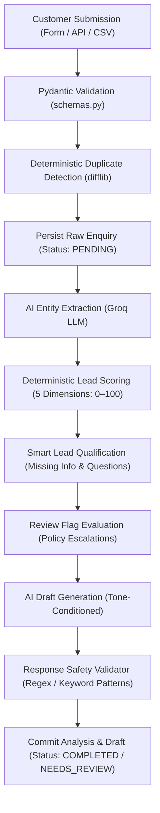

# Curd Rice Business Studio — Technical Architecture & Project Documentation

This document outlines the core architectural principles, system design choices, data flow pipelines, and engineering decisions implemented in the AI-Powered Business Enquiry Automation System.

---

## 1. Executive Summary & Architecture Philosophy

The system was engineered around a core production principle: **Decouple generative AI from deterministic business rules**.

* **Generative AI Scope (~20% of system execution):** Confined strictly to unstructured text parsing (entity extraction) and initial communication drafting using Groq LLM API (`openai/gpt-oss-120b`).
* **Deterministic Engineering Scope (~80% of system execution):** Data ingestion, validation, duplicate enquiry detection, 5-dimension lead scoring, lead qualification, response safety validation, database persistence, and human review dispatch.

By deliberately omitting complex orchestration frameworks (such as LangChain or autonomous agent loops), the system achieves sub-second latency, zero math hallucination, transparent auditing, and simple operational maintenance.

---

## 2. Ingestion & Core Data Flow

Every incoming enquiry moves through a strict 10-step transactional pipeline (`pipeline.py`):

---

## 3. Engineering Decisions & Design Rationales

### 3.1 Why Direct Groq SDK Over LangChain / Agent Frameworks?
* **Predictability & Debuggability:** Frameworks like LangChain add abstraction layers, fragile prompt chains, and hidden dependencies that complicate simple REST services.
* **Performance:** Direct API calls via Groq's official SDK with strict Pydantic schemas execute in <1s with full visibility into payloads, retries, and latency.

### 3.2 Deterministic 5-Dimension Lead Scoring Engine
LLMs produce non-deterministic scores across executions. The scoring engine (`lead_scoring.py`) uses explicit, explainable Python rules:

| Dimension | Max Points | Evaluation Logic |
|:--- |:---:|:--- |
| **Business Relevance** | 30 | Core Offerings (AI Automation: 30, App Dev: 28, Web Dev: 25, Consulting: 22). Secondary (18). Non-sales (5–8). |
| **Requirement Clarity**| 20 | Measured by scope length, technical specificity, and detail depth. |
| **Budget Information** | 15 | Quantified currency/numbers: 15 pts; unquantified mention: 8 pts; missing: 0 pts. |
| **Timeline & Urgency** | 15 | Stated urgency ("immediately", "this week"): 15 pts; near-term: 10 pts; unspecified: 0 pts. |
| **Project Scope** | 20 | Technical keywords ("ERP", "API", "automation") and quantified scale ("1000 users/day"). |
| **Total Score** | **100** | **High: 70–100 \| Medium: 40–69 \| Low: 0–39** |

Every score is accompanied by an itemized list of human-readable justifications recorded in `scoring_reasons`.

### 3.3 Multi-Tiered Safety & Policy Guardrails
1. **Pre-Draft Escalation:** Enquiries classified as *Complaints*, *Job/Internship Applications*, or *Partnerships* are automatically flagged with `requires_human_review = True`, bypassing automated completion.
2. **Post-Draft Safety Validator:** Before a draft enters the human review queue, a deterministic validator checks for:
   - Invented pricing or unverified fee commitments (`$`, `₹`, `cost is`).
   - Delivery date guarantees or contractual promises.
   - Missing professional greetings or sign-offs.
   - Dismissive tone in complaint responses.
   Drafts failing validation are escalated to `NEEDS_REVIEW` with severity-tagged issue logs.

### 3.4 In-Memory Duplicate Detection
Rather than introducing heavy vector databases (Pinecone, ChromaDB), the system uses `difflib.SequenceMatcher` with email normalization and text cleaning over a configurable rolling time window (default: 7 days, 0.85 similarity threshold). Duplicate records are flagged and linked to their original enquiry ID without discarding customer follow-ups.

### 3.5 Human-in-the-Loop & Zero Auto-Sending
To prevent legal liability and brand damage from hallucinations, automated emails are **never dispatched autonomously**. The UI provides a **Gmail Compose URL / mailto:** integration that pre-fills recipient, subject, and validated body directly in the reviewer's client, leaving final dispatch under human control.

---

## 4. Resilience & Data Integrity

* **Submission Safety:** Raw enquiries are persisted to PostgreSQL/SQLite before any external network call. If Groq times out or errors, the enquiry is never lost and transitions to `FAILED` or `NEEDS_REVIEW` for manual handling.
* **Dual Database Support:**
  - **PostgreSQL (Production):** High-concurrency relational backend with connection pooling and `pool_pre_ping`.
  - **SQLite (Development / Testing):** Lightweight, zero-config local storage with cross-thread connection pooling.
* **Schema Auto-Migration:** On boot, `create_tables()` inspects the active database and applies missing columns automatically to prevent schema drift errors across updates.

---

## 5. Quality Assurance & Test Strategy

The project maintains **53 automated tests** executing in **< 1.0s**:

| Test Suite | Count | Focus Areas |
|:--- |:---:|:--- |
| `test_schemas_and_validation.py` | 8 | Input sanitization, field boundaries, category normalization |
| `test_lead_scoring.py` | 6 | Boundary conditions, priority thresholds, score explainability |
| `test_api_and_pipeline.py` | 6 | End-to-end pipeline execution, policy escalation, approval flows |
| `test_duplicate_detection.py` | 9 | Exact/fuzzy matches, time-window filtering, email cleaning |
| `test_response_validator.py` | 7 | Pricing flags, guarantee detection, complaint sentiment |
| `test_qualification_and_export.py`| 4 | Missing info identification, question drafting, CSV export |
| `test_email_compose.py` | 5 | URL encoding, multiline formatting, mailto fallbacks |
| `test_csv_upload_extended.py` | 5 | Column aliasing, malformed CSV tolerance, partial batches |
| `test_frontend_views.py` | 3 | HTML view rendering, web form submission flows |

External dependencies (Groq API) are mocked across the entire test suite, enabling reproducible zero-secret execution in GitHub Actions CI.

---

## 6. Containerization & Deployment

* **Docker:** Built on `python:3.12-slim` with multi-stage compilation dependencies, unbuffered logging, non-root execution guidelines, and automated `/api/health` health checks.
* **Docker Compose:** Persistent volume mapping (`app_data:/app/data`) ensuring database state is maintained across container restarts.
* **CI/CD:** GitHub Actions workflow executing test suites on every pull request to ensure regressions are caught prior to merge.

